# credit-risk-ml

Пет-проект **табличного кредитного скоринга**: постановка → данные → валидация → модели → метрики → serving.

## Задача

Бинарная классификация дефолта (`TARGET=1`). Сильный дисбаланс (~8%).  
Валидация **только chronological** (без random KFold): train → valid → test.

- **Home Credit (основной режим):** фичи `application` + агрегаты `bureau` / `previous_application` / `installments`.  
  Proxy-время: `DAYS_ID_PUBLISH` (календарной даты заявки в датасете нет).
- **Synthetic (smoke/CI):** Home-Credit-подобный генератор с `application_date`.

### Split и leakage (кратко)

- Сплит строго по времени / proxy-времени: future заявки не попадают в train.
- `SK_ID_CURR` не подаётся в модель (нет id-мемоизации).
- Поля `DAYS_*` в bureau уже относительно даты заявки; calendar as-of join без timestamp невозможен — это ограничение датасета, не «тихий» future leak.
- Champion выбирается по **valid Gini**; test только для отчёта.

## Стек

- Python, Pandas, scikit-learn  
- Gradient boosting: **CatBoost** (default, если установлен) иначе `HistGradientBoosting`  
- **PyTorch** tabular MLP  
- Метрики: **ROC-AUC, Gini, KS, PR-AUC** + калибровка (Platt) + порог max KS  
- Serving: FastAPI `/predict` + `artifacts/champion.joblib`  
- Опционально: MLflow, DuckDB SQL-агрегаты bureau

## Быстрый старт

```bash
cd public-credit-risk-ml
python -m venv .venv && source .venv/bin/activate
pip install -e ".[dev]"
# рекомендуется: pip install -e ".[catboost,duckdb,mlflow]"

# Home Credit
python scripts/unpack_home_credit.py ~/Downloads/home-credit-default-risk.zip
python scripts/plot_home_credit_eda.py
python scripts/run_pipeline.py --dataset home_credit
# быстрый прогон: --nrows 30000 --torch-epochs 3
python scripts/plot_report_figures.py   # сводные графики из metrics.json

# Synthetic smoke
python scripts/run_pipeline.py --dataset synthetic

pytest -q

# API (после пайплайна; предпочитает champion_calibrated.joblib)
uvicorn api.main:app --app-dir . --reload
# synthetic: POST /predict  |  home_credit: POST /predict/raw {"features": {...}}

# MLflow (optional)
# pip install -e ".[mlflow]"
# mlflow ui --port 5000
# MLFLOW_TRACKING_URI=http://127.0.0.1:5000 python scripts/run_pipeline.py --dataset home_credit --nrows 20000
```

## Результаты: Home Credit

`results/metrics.json` после:

```bash
python scripts/run_pipeline.py --dataset home_credit --nrows 40000 --torch-epochs 5
```

| Модель | Test ROC-AUC | Gini | KS | PR-AUC |
|--------|-------------:|-----:|---:|-------:|
| logistic | 0.737 | 0.473 | 0.356 | 0.243 |
| **boosting (CatBoost, champion)** | **0.740** | **0.479** | **0.370** | **0.265** |
| torch_nn | 0.736 | 0.471 | 0.353 | 0.236 |

Параметры: `n_samples=40000`, `default_rate≈0.081`, `split=time_based_proxy` по `DAYS_ID_PUBLISH`, `boosting_backend=catboost`, `selection_rule=max_valid_gini`.  
OOF boosting Gini: **0.473 ± 0.028** (3 temporal folds).

Фичи: application (+ age/employment/ratios/EXT_SOURCE) + bureau/prev/installments агрегаты.  
Артефакты: `champion.joblib`, `champion_calibrated.joblib`, `model_meta.json`.  
Порог по valid: **max KS** + operating point на test (precision/recall/FPR/approval_rate).

Доп. метрики champion (calibrated, test, n=40k):

| Brier | ECE | PSI train→test | Top-decile lift | Capture@3 deciles |
|------:|----:|---------------:|----------------:|------------------:|
| 0.081 | 0.006 | 0.037 (stable) | 3.09× | 63% |

Operating point на test (порог max-KS с valid ≈ 0.09): precision **0.19**, recall **0.69**, FPR **0.33**, approval_rate **0.64**.  
PSI: `<0.1` stable, `0.1–0.25` watch, `>0.25` shift.

Драйверы риска (importance top): `ext_source_mean`, `EXT_SOURCE_3`, `age_years`, `employment_years`, `bureau_days_credit_max`, `EXT_SOURCE_2`.

### Synthetic (регресс / CI)

| Модель | Test ROC-AUC | Gini | KS | PR-AUC |
|--------|-------------:|-----:|---:|-------:|
| logistic | 0.750 | 0.500 | 0.425 | 0.161 |
| boosting | 0.732 | 0.463 | 0.416 | 0.137 |
| torch_nn | 0.765 | 0.530 | 0.440 | 0.175 |

`n=12000`, seed=42, time-based по `application_date`.

## Графики (для описания проекта)

Все PNG лежат в `results/figures/`. Сводка из метрик: `python scripts/plot_report_figures.py`.  
EDA: `python scripts/plot_home_credit_eda.py`.

### 1. Сравнение моделей

Champion = boosting по valid Gini; на test бустинг чуть впереди по Gini/KS/PR-AUC.

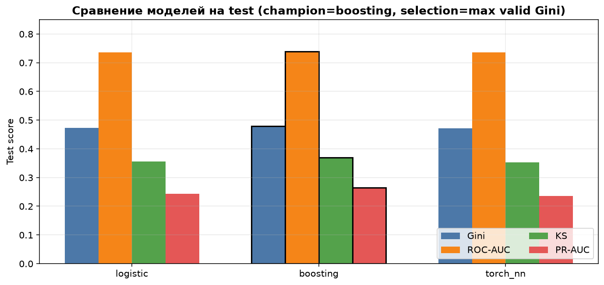

### 2. Стабильность temporal OOF

Expanding-window фолды по proxy-времени: mean Gini ≈ 0.47, разброс между фолдами умеренный.

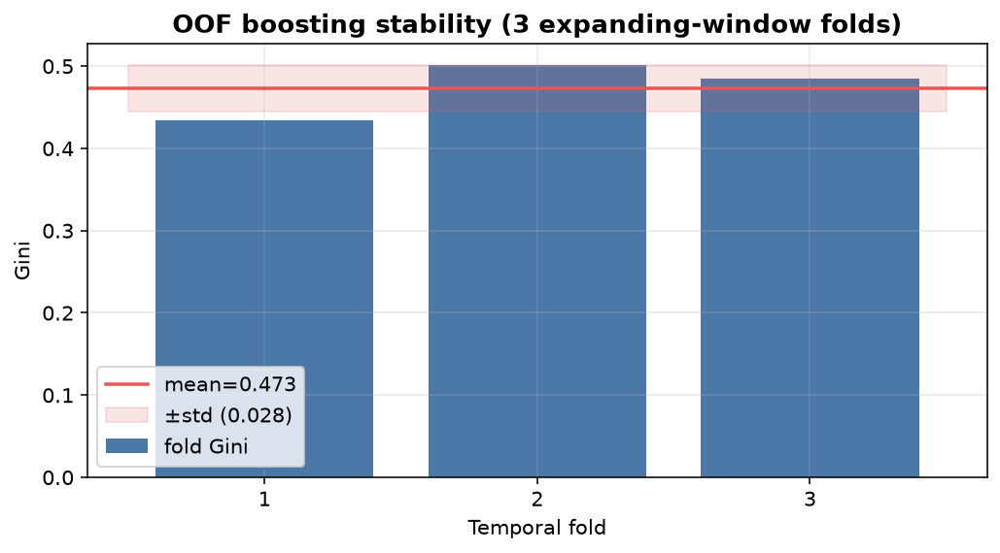

### 3. Калибровка PD

Reliability на test после Platt на valid — вероятности ближе к наблюдаемой частоте дефолта.

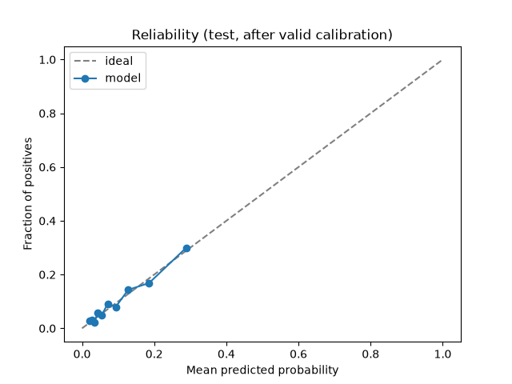

### 4. Operating point

Порог max-KS с valid; на test — trade-off precision / recall / FPR / approval.

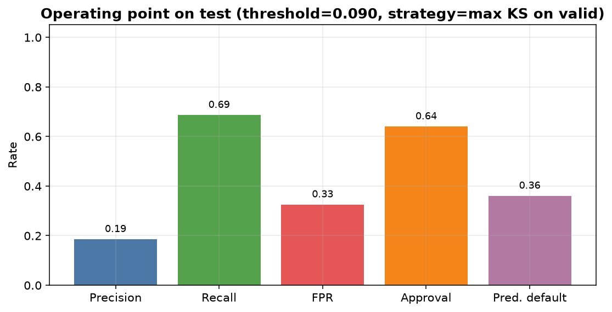

### 5. Ранжирование риска (децили)

Топ децили концентрируют дефолты (lift > 1); capture растёт быстрее random baseline.

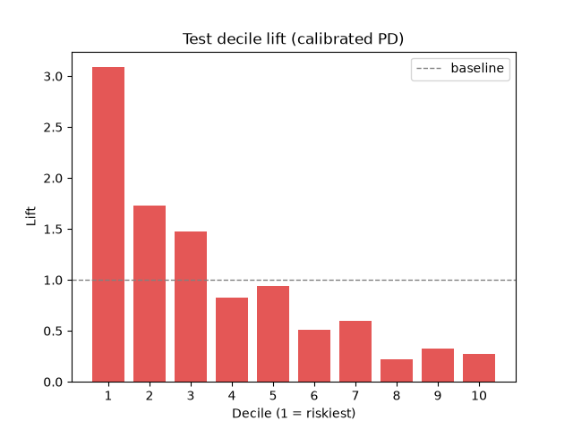

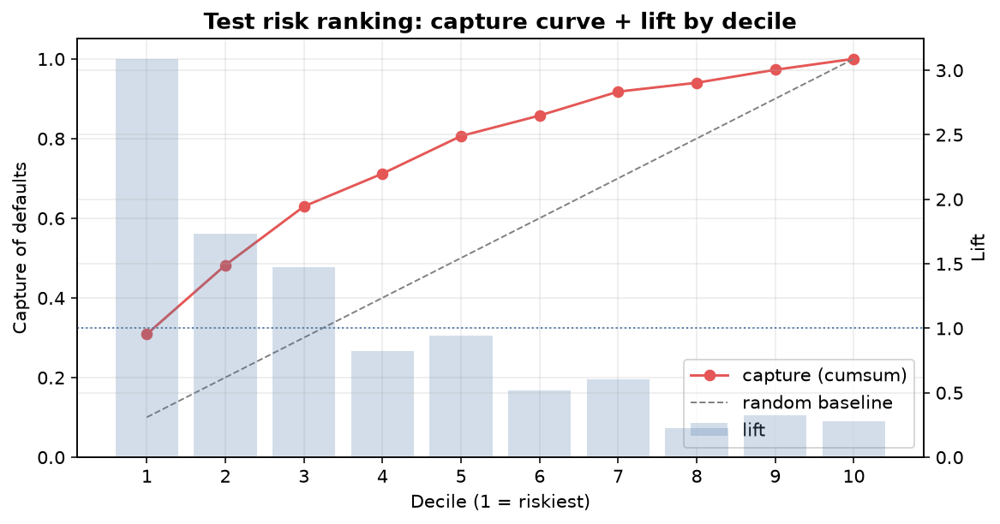

### 6. PSI train → test

Распределения калиброванного PD близки (PSI ≈ 0.037 → stable).

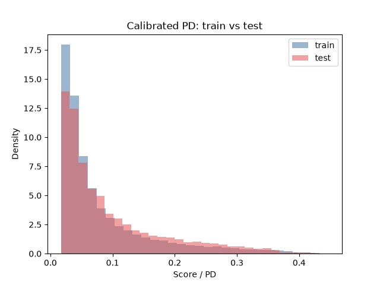

### 7. Интерпретация

Топ драйверов: внешние скоры, возраст, стаж, bureau days.

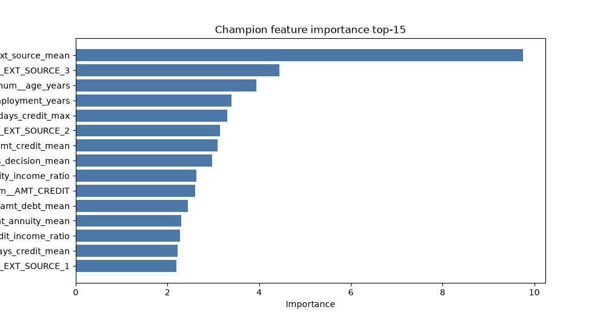

### 8. EDA Home Credit

Дисбаланс таргета, пропуски, распределения и корреляции:

| | |
|---|---|
| 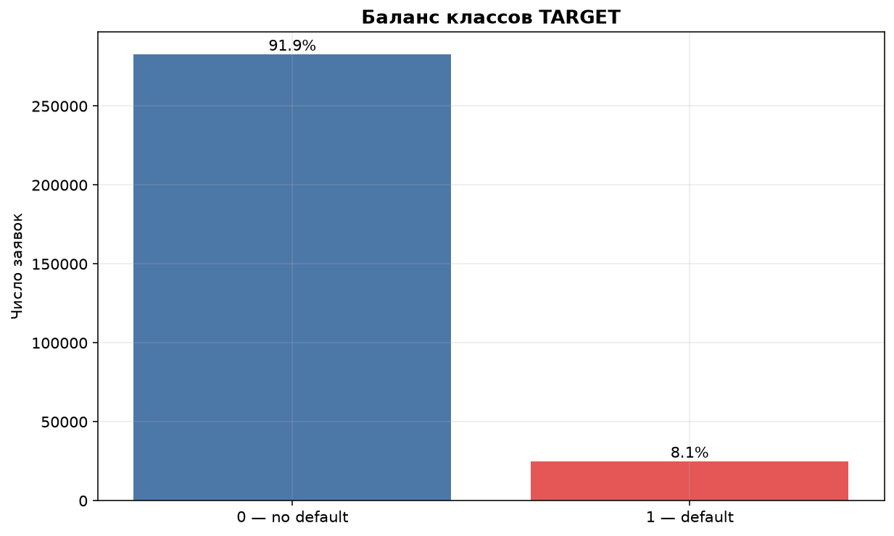 | 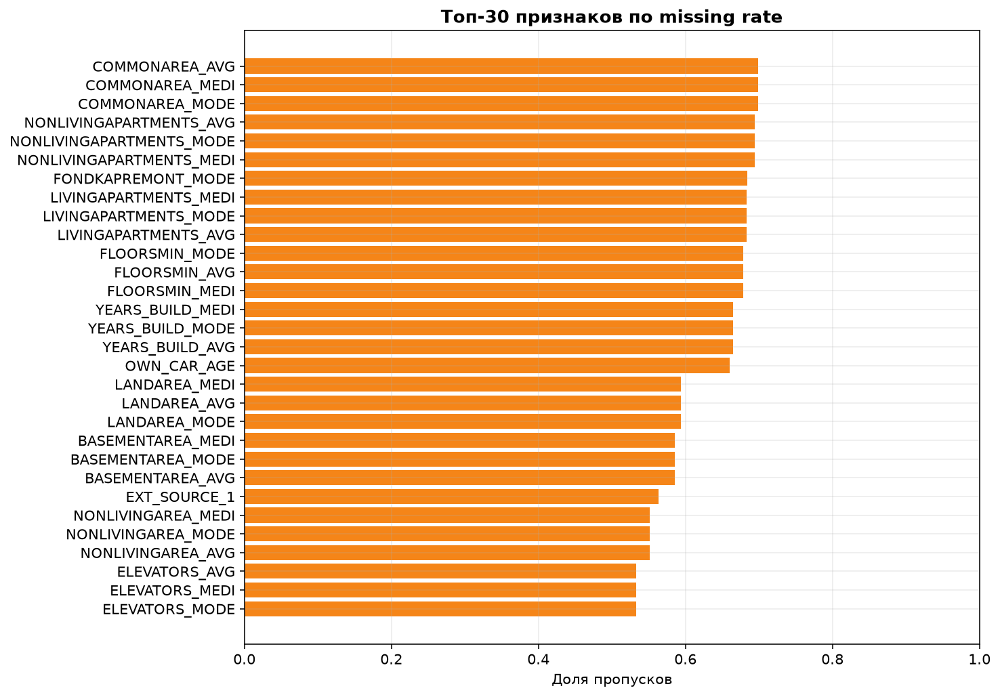 |
| 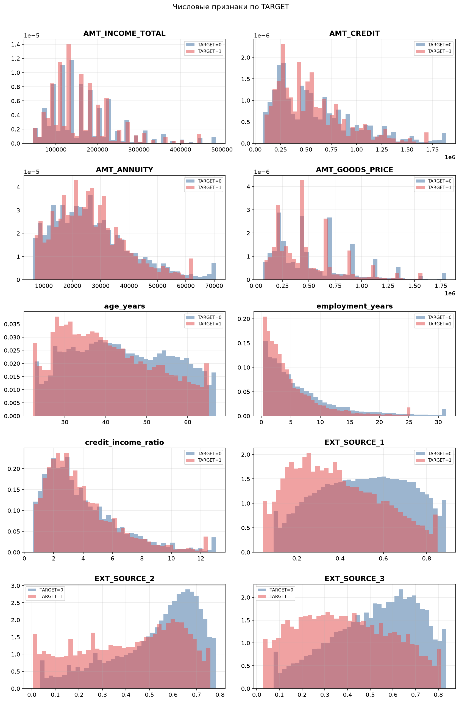 | 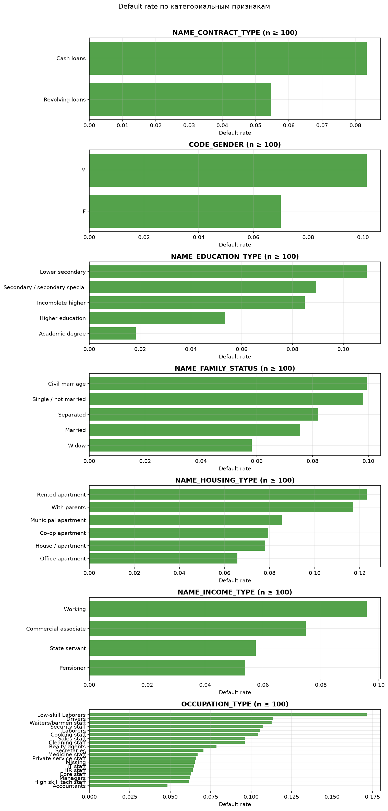 |

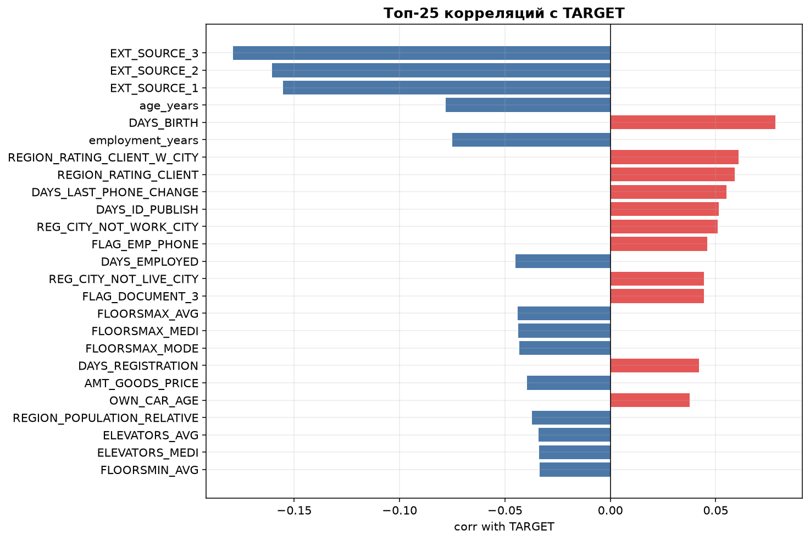

## Почему такой split

В банке скорим будущие заявки. Random KFold смешивает время → утечка будущего и завышенный AUC.  
На Home Credit нет `application_date`, поэтому proxy `DAYS_ID_PUBLISH` + temporal OOF (expanding window) по бустингу.

## Структура

```
src/credit_risk/
  data/          # I/O, synthetic, Home Credit loaders
  features/      # synthetic + Home Credit feature engineering
  validation/    # time-based split, leakage checks
  models/        # logistic, boosting, torch MLP
  evaluation/    # metrics, calibration, threshold, deciles, PSI, explain
  pipeline/      # orchestration: load → fit → evaluate → postprocess → persist
  serving/       # model_meta + scoring frame
  tracking/      # optional MLflow
  eda/           # Home Credit EDA plots
  paths.py       # REPO_ROOT, data/results/artifacts
sql/bureau_aggregates.sql
scripts/         # run_pipeline, unpack, EDA, report figures, DuckDB, importance
api/main.py
results/figures/ # PNG для описания результатов
tests/           # data, features, validation, models, evaluation,
                 # pipeline, serving, tracking, eda, integration
```

## Ключевые решения

1. **Задача:** вероятность дефолта; метрики Gini/KS удобны для риск-отчётности.  
2. **Time-based / proxy split:** иначе утечка будущего; score distribution дрейфует во времени.  
3. **Бустинг (CatBoost):** табличные данные + categoricals + нелинейности.  
4. **PyTorch MLP:** альтернативный tabular baseline; на чистой таблице бустинг часто сильнее.  
5. **Serving:** champion → `/predict`; трекинг прогона через **MLflow** (optional).  
6. **Интерпретация:** importance top-15 + калибровка PD + порог по KS.
